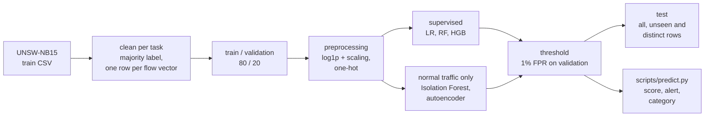

# Anomaly Detection in Network Traffic Using Machine Learning

Which network flows are attacks, and what would a detector built on them mean for a SOC? On the UNSW-NB15 dataset, supervised classifiers (attack vs normal, and attack category) are compared with anomaly detectors trained on normal traffic only. Every model gets its alert threshold from a fixed false-positive budget on validation, and is judged on alerts per day, missed attacks and how well it holds up on attack types it has never seen.

This is a rebuild of an earlier version of the project whose results were not methodologically valid; the old notebook is kept in `notebooks/00_original_reference.ipynb` for reference only.

---

## Results
Test set, alert threshold at 1% FPR on validation for every model. Recall, FPR and precision are on all test rows (precision is high because the test file is 55% attacks; at realistic attack rates it collapses, see Security perspective). The distinct columns count each repeated flow once and are what models are compared on. The random forest is the model selected on validation and the one served by `scripts/`. Generated by `notebooks/06_results.ipynb` from `reports/results.json`.

| model | trained on | recall | FPR | precision | ROC-AUC | recall, distinct | macro detection, distinct |
|---|---|---|---|---|---|---|---|
| LogisticRegression | attacks + normal | 80.4% | 2.5% | 97.5% | 0.968 | 63.1% | 0.69 |
| RandomForest | attacks + normal | 89.1% | 4.0% | 96.5% | 0.982 | 79.8% | 0.86 |
| HistGradientBoosting | attacks + normal | 92.0% | 4.8% | 95.9% | 0.985 | 85.5% | 0.90 |
| IsolationForest | normal only | 61.1% | 2.6% | 96.6% | 0.881 | 29.5% | 0.38 |
| Autoencoder | normal only | 60.6% | 3.1% | 96.0% | 0.908 | 30.4% | 0.37 |

Attack category (multi-class), macro-F1 against a ceiling of 0.76 set by flows that appear in test with more than one label:

| model | macro-F1, validation | accuracy | macro-F1 | macro-F1, distinct |
|---|---|---|---|---|
| LogisticRegression | 0.52 | 72.9% | 0.40 | 0.39 |
| RandomForest | 0.74 | 70.3% | 0.50 | 0.52 |
| HistGradientBoosting | 0.74 | 71.2% | 0.51 | 0.52 |

In short:
- The threshold does not transfer: set for 1% FPR on validation, it gives 4.0% on test for the random forest. The extra false alarms are concentrated in normal traffic with the TTL that attacks have in this testbed.
- The supervised models catch every attack type they have seen at 87% or more except Fuzzers (about 30%), which looks like normal traffic at flow level. Held out of training, the random forest still catches Backdoor, Worms, DoS and Analysis (87-97%), but not Generic, Reconnaissance or Fuzzers (29-49%).
- The anomaly detectors catch about 30% of distinct attack flows. Their one clear win is Generic held out of training (80-87% against 29-35% for the random forest), and they are sensitive to their settings.
- At a realistic attack rate a per-flow classifier gives far more false alerts than true ones, whatever the model.

## Approach


## Project layout
```
src/netad/         data loading and checks, preprocessing, evaluation, models (random forest, autoencoder)
scripts/           train.py and predict.py
notebooks/         analysis, one notebook per step (list below), checks.ipynb
reports/           results.json, leave-one-out tables, figures
models/            trained models (not in git)
docs/              material from the earlier version (outdated results)
```

---

## Security perspective
What the binary models would mean for a SOC. Numbers are on the UNSW-NB15 test set with the alert threshold set for 1% FPR on validation; details in `notebooks/05_security.ipynb`.

**Alert volume.** On a sensor seeing 1M flows a day, the random forest's 4.0% test FPR means ~39,000 false alerts a day instead of the ~10,000 planned at 1%. If 1% of flows are attacks it catches 80% of them and 17% of its alerts are real; at 0.1%, closer to a real network, 2%, about 50 false alerts for every true one. The threshold drift is not the whole story: even at the 1% FPR the threshold was set for, precision would be 45% and 7.4%, and for half the alerts to be real at 0.1% attacks the FPR would have to be 0.08%, 50 times lower than on test. A per-flow classifier is not usable as an alert source on its own: flows would have to be grouped by host and time window and ranked before an analyst sees them.

**Where the false alarms are.** 87% of them are normal flows with `sttl` 254, which is 41% of normal test traffic and 19% of validation: TCP connections with no recognised service closed with FIN, and one-way UDP flows (state INT, 13% FPR). `sttl` is a marker, not the cause; a model trained without the TTL columns splits normal traffic the same way. It points at traffic from particular testbed hosts, a trait of the lab rather than of attacks. On a real network TTL depends on the operating system and the number of hops, so this is the first thing that would not carry over.

**Blind spot: Fuzzers.** Three quarters of the missed attacks are Fuzzers, and 70% of distinct Fuzzers flows get through. The missed ones look like the false alarms: TCP, no service, FIN, sttl 254, ~10 packets in ~0.6 s, a few hundred bytes each way. At flow level that part of the attack traffic and that part of the normal traffic can't be told apart; payload or the sequence of a host's flows would be needed.

**Where anomaly detection helps.** With Generic held out of training, the random forest catches 29-35% of it (three seeds), Isolation Forest and the autoencoder, which only ever see normal traffic, 80-87%. For the other categories the supervised model wins even without having seen them. Overall the anomaly detectors miss ~70% of distinct attack flows at 2.6-3.7% test FPR (over three seeds), depend strongly on their settings and, for the autoencoder, on the seed: a second opinion for unusual traffic, not the main detector.

**MITRE ATT&CK.** UNSW-NB15 categories are traffic classes from an attack generator, not ATT&CK techniques, so the mapping is at tactic level and approximate. Detection rates are on distinct test rows; "held out" means the category was removed from training (`notebooks/04_leave_one_out.ipynb`).

| Category | Tactic | Example technique | RF, seen | RF, held out (3 seeds) | Isolation Forest / autoencoder |
|---|---|---|---|---|---|
| Reconnaissance | Reconnaissance (TA0043), Discovery (TA0007) | T1595 Active Scanning, T1046 Network Service Discovery | 95% | 46-49% | 10% / 9% |
| Analysis (port scans, spam, HTML file penetration) | Reconnaissance (TA0043), Discovery (TA0007); the spam part is closer to Initial Access (TA0001) | T1046 Network Service Discovery; T1566 Phishing for spam | 87% | 87% | 82% / 78% |
| Fuzzers | Reconnaissance (TA0043) | T1595.002 Vulnerability Scanning (closest) | 30% | 29-34% | 11% / 12% |
| Exploits | Initial Access (TA0001), Execution (TA0002), Privilege Escalation (TA0004) | T1190 Exploit Public-Facing Application, T1068 Exploitation for Privilege Escalation | 93% | 76-78% | 17% / 20% |
| Shellcode | Execution (TA0002) | the payload of an exploit | 87% | 78-81% | 0% / 0.5% |
| Backdoor | Persistence (TA0003), Command and Control (TA0011) | T1071 Application Layer Protocol | 98% | 96-97% | 85% / 82% |
| Worms | Lateral Movement (TA0008) | T1210 Exploitation of Remote Services | 93% (44 rows) | 93-96% | 16% / 16% |
| DoS | Impact (TA0040) | T1498 Network Denial of Service, T1499 Endpoint Denial of Service | 92% | 89-90% | 39% / 38% |
| Generic (attacks on block ciphers) | no clean match | – | 98% | 29-35% | 80% / 80% |

Read as coverage, the weakest stages are the early ones: scanning and fuzzing, especially when the model hasn't seen that kind of traffic, which is where an early warning would be worth most. Autoencoder numbers are for seed 42; other seeds move some categories a lot (Analysis 46-78%).

**Limits.**
- Synthetic traffic from 2015, generated with IXIA PerfectStorm in one testbed. All attack categories come from the same tool and hosts.
- Shortcut features: TTL and other traits of the testbed hosts separate the classes. Nothing here shows the models would carry over to another network.
- Decisions are per flow. These files have no timestamps or IP addresses, so flows can't be grouped by host or session or correlated over time; the `ct_*` counters (connections among the last 100) are the only multi-flow context.
- The test file is 55% attacks, far from a real network, and was looked at many times during development (see Evaluation protocol), so the numbers are exploratory. Leave-one-attack-out is not evidence of zero-day detection.

---

## Dataset
The project uses the [UNSW-NB15 dataset](https://research.unsw.edu.au/projects/unsw-nb15-dataset) (UNSW Canberra): labelled network flows with normal traffic and 9 attack categories (`Fuzzers`, `Analysis`, `Backdoor`, `DoS`, `Exploits`, `Generic`, `Reconnaissance`, `Shellcode`, `Worms`), generated with the IXIA PerfectStorm tool in the Cyber Range Lab of UNSW Canberra.
The official train/test files contain 42 features per flow, plus `label` (0 normal, 1 attack) and `attack_cat`.

If you use the dataset, cite its authors:
- N. Moustafa and J. Slay, "UNSW-NB15: a comprehensive data set for network intrusion detection systems (UNSW-NB15 network data set)", *Military Communications and Information Systems Conference (MilCIS)*, IEEE, 2015.
- N. Moustafa and J. Slay, "The evaluation of Network Anomaly Detection Systems: Statistical analysis of the UNSW-NB15 data set and the comparison with the KDD99 data set", *Information Security Journal: A Global Perspective*, 25(1-3), 18-31, 2016.

---

## Installation
```bash
python -m venv .venv
.venv\Scripts\activate          # Windows (PowerShell: .venv\Scripts\Activate.ps1)
source .venv/bin/activate       # Linux / macOS
pip install -r requirements.txt
pip install -e .
```

Without an NVIDIA GPU, the CPU-only PyTorch build is much smaller: `pip install torch --index-url https://download.pytorch.org/whl/cpu`.

## Data
The dataset files are not stored in this repository. Download `UNSW_NB15_training-set.csv` and `UNSW_NB15_testing-set.csv` from the [UNSW-NB15 page](https://research.unsw.edu.au/projects/unsw-nb15-dataset) and place them in `data/raw/`.

### Data handling
- The official train/test split is kept (175,341 / 82,332 flows).
- Train is cleaned separately for each task (`label` for binary, `attack_cat` for multi-class): feature vectors with more than one label keep the majority label (ties are dropped), then only one row per feature vector is kept. 20% of it is then held out as a stratified validation set, used for thresholds and tuning (`train_val_split` in `src/netad/data.py`).
- Preprocessing is fitted on the training part only: `log1p` + standard scaling on numeric columns, one-hot on `proto`, `service`, `state` with rare and unseen categories grouped together (`build_preprocessor` in `src/netad/preprocessing.py`).
- Test is not modified. Results are reported on the full test set, on the test rows whose features do not appear in train (10.4% of test rows do) and on the distinct test rows (55,945 of 82,332, each feature vector + category once, `distinct_rows` in `src/netad/data.py`).

### Known dataset issues
- The train/test overlap is uneven across classes: 49% of DoS test rows also appear in train, against 4% of Normal. DoS scores on the full test set will be optimistic.
- In test, 91% of Analysis and 90% of Backdoor rows share their feature vector with another class. Multi-class accuracy can't go above ~94%, and recall on these two classes can't go above ~10%. Binary detection is not affected.
- The TTL columns (`sttl`, `dttl`, `ct_state_ttl`) alone give ~79% test accuracy. They most likely reflect the testbed topology rather than attack behaviour. In training, `sttl` 31 appears only in normal traffic, attacks have 62 or 254. Normal test flows with sttl 31 get no false alarms from the random forest, those with 254 get 8.5%, and test has twice as much of that traffic as validation (41% vs 19% of normal flows). The whole rise from 1% FPR on validation to 4.0% on test is concentrated in those flows. That is an association, not a demonstrated cause: a random forest trained without the TTL columns splits normal traffic the same way, so `sttl` most likely marks traffic from particular testbed hosts that differs in other columns too. Isolation Forest and the autoencoder, which never see an attack, show the same direction but not the same picture: sttl 254 flows make up about two thirds of the Isolation Forest test FPR and under half of the autoencoder's; for the autoencoder the sttl 31 group rises too (0.4% -> 1.1%), and the small group of other sttl values gets ~20% FPR on test with both.
- Test repeats some attack flows many times, mostly ones that are easy to detect (Generic is 42% of test attacks, 17% of the distinct ones). Counting each distinct flow once, test recall drops from 89% to 80% for the random forest and from 61% to 29% for Isolation Forest.

Details in `notebooks/01_eda.ipynb`.

## Usage
Train the random forest and save it to `models/` (about a minute; `--multiclass` also trains the attack category model):
```bash
python scripts/train.py --multiclass
```
It uses the hyperparameters saved in `reports/results.json` by `02_supervised` with the same split and seed, so it rebuilds the model reported there; the alert threshold is the one for 1% FPR on validation. Next to each model a `.json` file records the threshold, validation results, creation time and library versions.

The scripts serve only the random forest, on purpose. It is the binary model selected on validation in `02_supervised`; gradient boosting ranks flows slightly better on test, but switching after looking at test would break the evaluation protocol. Isolation Forest and the autoencoder stay in the notebooks as experiments: they miss about 70% of distinct attack flows and depend strongly on their settings and, for the autoencoder, on the seed, so they are not offered as a detector. `03_anomaly` still saves the autoencoder, its preprocessor and threshold to `models/` (`load_autoencoder` in `src/netad/models/autoencoder.py`) for anyone who wants to score with it.

Score a CSV of flows:
```bash
python scripts/predict.py --input data/raw/UNSW_NB15_testing-set.csv --output alerts.csv --category
```
The input needs the 42 UNSW-NB15 feature columns; other columns are ignored. Input that can't be scored stops the script with an error naming the column: a missing column, an empty value, a blank `proto`/`service`/`state` (the dataset writes `-` for none), text in a numeric column, a negative or infinite value (every feature is a count, size, time or rate), or a file with no rows. A detector that quietly scored impossible values would be easy to evade. Values of `proto`, `service` or `state` never seen in training are scored (they share the "infrequent" one-hot column) but counted in a warning, as a sign that the traffic has drifted from the training data; on the test file that is 33 flows for `proto` and 5 for `state`.

The output has one row per flow: `id` (if the input has one), `score` and `alert` (score at or above the threshold). With `--category` it also has the most likely attack category, for flows with an alert only, picked among attack classes so it never says Normal for an alert. The category comes from a separate multi-class random forest; it doesn't change the alert, which is decided by the binary model alone. It is indicative: the multi-class model has a macro-F1 of about 0.50 on test, and Analysis, Backdoor and DoS mostly come out as Exploits. On the test file the alerts match `02_supervised`: 89.1% of attacks flagged at 4.0% FPR.

**Security note:** the models are saved with `joblib`, which uses pickle: loading a file runs code stored in it. Only load models you trained yourself. The autoencoder weights are loaded with `torch.load(..., weights_only=True)`.

The random forests are saved compressed (about 70 MB binary, 35 MB multi-class). Scores are averaged over trees in parallel threads, so the last digit of a score, and of the threshold computed from validation scores, can differ between runs (~1e-16).

## Evaluation
- Binary: precision, recall, F1, FPR, ROC-AUC, PR-AUC and confusion matrix. The alert threshold is chosen on validation with an FPR budget (1% by default), not on test (`choose_threshold` in `src/netad/evaluation.py`). The supervised models use the `"fpr"` mode: highest recall within the budget, so attack labels of validation are used too. Isolation Forest and the autoencoder use `"normal_quantile"`: the lowest normal score with at most 1% of normal validation flows at or above it, so no attack example is needed. Switching the anomaly detectors from `"fpr"` to `"normal_quantile"` left test results practically identical (recall changed by under 0.1 point).
- Detection rate per attack category, and `macro_detection`, their mean over the 9 attack categories. Recall depends on which categories are frequent in a given set, `macro_detection` does not.
- Multi-class: accuracy, macro and weighted F1, per-class precision/recall/F1 and confusion matrix.
- Every model is reported on validation, on the full test set, on the unseen test rows and on the distinct test rows. All rows give the alert volume on the traffic as it comes. Final model selection uses validation metrics. Distinct test rows are used for exploratory comparisons.
- Distinct test rows keep one row per pair of feature vector and `attack_cat`. Exact repeats within a category count once. If a vector has multiple category labels, each label is retained. Deduplication does not establish statistical independence: 8.7% of them differ from another row only in the 11 timing columns (`dur`, `rate`, `sload`, `dload`, `sinpkt`, `dinpkt`, `sjit`, `djit`, `tcprtt`, `synack`, `ackdat`), a third of Generic, and 4.6% share their feature vector with another category (12 rows have both Normal and an attack label, the rest are attack vs attack). The distinct subset shows how detection rates change when each feature vector and category pair has equal weight. Use the full test set for operational comparisons of FPR, precision and alert volume, where each flagged row counts as an alert. Grouping flows properly would need source IPs and timestamps, which only the full UNSW-NB15 CSVs have; for the same reason a bootstrap on distinct rows would give intervals that are too narrow.
- Results are collected in `reports/results.json` (`src/netad/evaluation.py`).
- Anomaly detector settings are compared with seeds 42, 1 and 2. The final evaluation uses seed 42. Autoencoder results can vary across machines and library versions, including the epoch at which training stops.

## Evaluation protocol
The UNSW-NB15 test split was inspected repeatedly during development. Its results are exploratory because that inspection informed choices about preprocessing, reporting and follow-up experiments.

Decisions based on training and validation data
- hyperparameters of the supervised models (cross-validation on the training part);
- the final model of each task (validation partial ROC-AUC / macro-F1; the random forest was kept although gradient boosting scored higher on test);
- Isolation Forest and autoencoder settings (validation, 3 seeds);
- alert thresholds under a 1% validation FPR budget (highest recall within the budget for the supervised models, normal validation scores only for Isolation Forest and the autoencoder).

Decisions informed by test inspection
- reporting on distinct test rows and adding `macro_detection`, after seeing how repeated flows raise recall;
- the FPR breakdown by `sttl`, computed on test;
- the error analysis and alert estimates in `05_security`, computed on test as a diagnostic; no model or threshold was changed after them;
- the comparisons at the same FPR in `03_anomaly` and `04_leave_one_out`, where each model's threshold is picked on test so that all of them sit at 1%, 2% or 5% test FPR. They separate how well a model ranks flows from how well its calibration transfers; they are diagnostics, not deployment results, since such a threshold can't be set without the test labels;
- `OneHotEncoder(handle_unknown="infrequent_if_exist")`, after seeing `state` values in test that train doesn't have (5 rows).

`04_leave_one_out` is an exploratory held-out-category analysis, not evidence of zero-day detection. Hyperparameters and anomaly detector settings were chosen with all categories present, and all categories come from the same attack tool (IXIA PerfectStorm) and hosts, so a held-out category still shares traffic characteristics with the ones the model was trained on. Detecting attacks from a different source would need traffic from a different network. An earlier version held out six categories chosen partly on test results; all nine are now included, Worms (44 distinct test rows) with a 95% Wilson interval. The main models are repeated with three seeds (split and fits): the random forest and Isolation Forest move by at most 6 points per category, the autoencoder by up to 31 (Analysis 46-78%), so its single-seed numbers should be read with that spread.

The current configurations are fixed for this benchmark. Any future model development uses training and validation data. Before evaluating on independently collected traffic, freeze the preprocessing, model, threshold and metrics. Use that evaluation to assess generalisation beyond the UNSW-NB15 testbed. CIC-UNSW-NB15 and the full 2.5M-record UNSW-NB15 come from the same captures and testbed, so they don't qualify; a model trained on CICFlowMeter features (CIC-UNSW-NB15) and evaluated on independently collected traffic with compatible feature definitions is one possible design.

## Notebooks
- `00_original_reference.ipynb` – the old version, kept for reference only
- `01_eda.ipynb` – dataset analysis
- `02_supervised.ipynb` – supervised models: tuning, test results, TTL ablation, permutation importance
- `03_anomaly.ipynb` – models trained on normal traffic only (Isolation Forest, autoencoder), compared with the supervised ones. The trained autoencoder, its preprocessor and threshold are saved to `models/` (not in git)
- `04_leave_one_out.ipynb` – each attack category held out of training in turn: does the random forest, Isolation Forest or the autoencoder still catch it
- `05_security.ipynb` – false positives and false negatives of the random forest, alerts per day at realistic attack rates
- `06_results.ipynb` – summary tables and figures read from `reports/`, nothing retrained; generates the tables at the top of this README
- `checks.ipynb` – asserts on `src/netad/` and the scripts, run it after every change there

The notebooks run in order (02 before 03 and 04, which read its results). `02_supervised` takes about 10 minutes with `RUN_SEARCH = False` (it refits with the saved hyperparameters) and about 1.5 hours with the full search; `03_anomaly` about 40 minutes and `04_leave_one_out` about 35, mostly autoencoder training over three seeds.

## Earlier version
`docs/` keeps the report and presentation of the 2023-2024 version of this project. Their results are outdated and not methodologically valid (the autoencoder was scored per batch of 16 flows, not per flow); they are there for the record only.
